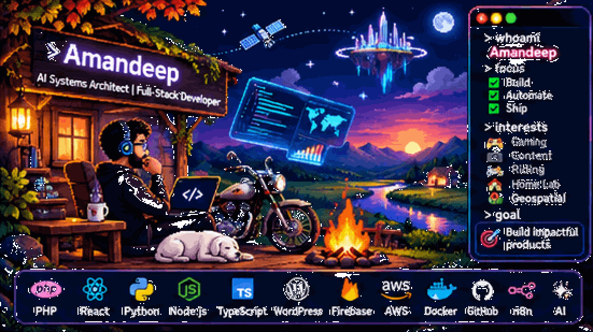

<!-- Animated profile hero -->

  

<h1 align="center">Hi, I'm Amandeep 👋</h1>
<h3 align="center">AI Engineer | GenAI & LLM Apps | Full-Stack Developer</h3>

  I build AI-native products, RAG systems, and automation workflows with Python/FastAPI, React/Next.js, and cloud/serverless architectures.

  <i>Open to remote AI, GenAI, and full-stack engineering opportunities.</i>

---

### Core expertise

- **AI / LLMs:** Generative AI, RAG, AI agents, prompt engineering, LangChain, LLM integrations (OpenAI, Claude, Gemini)
- **Backend:** Python, FastAPI, REST APIs, async processing, API-first architecture
- **Frontend:** React.js, Next.js, TypeScript, JavaScript, component-driven UI
- **Cloud / DevOps:** AWS Lambda, Firebase, Docker, Vercel, Cloudflare, CI/CD
- **Platforms:** Headless CMS, automation systems, scalable web applications

### What I work with

  
  
  
  
  
  
  
  
  
  
  
  
  
  
  
  
  
  
  
  
  

### Featured projects

- **AI Job Hunt Agent** — AI-powered job search platform concept for discovery, matching, document generation, tracking, and notifications. *Stack:* Next.js, Supabase, GitHub Actions, Gemini/LLM workflows.
- **AI Document Processing & RAG Workflows** — Contextual retrieval and intelligent response generation using prompt-driven pipelines and LLM integrations. *Stack:* Python, FastAPI, RAG, LLM APIs.
- **LLM Automation Systems** — Automation pipelines for content generation and workflow enhancement with multi-model LLM integrations. *Stack:* Python, APIs, OpenAI/Claude/Gemini.
- **AI-Integrated Admin & Web Platforms** — API-first platforms with intelligent automation features, scalable backends, and modern frontend experiences. *Stack:* FastAPI/Laravel, React/Next.js, serverless/cloud.

### Current focus

- Building practical AI agents, RAG systems, and orchestration workflows
- Shipping full-stack AI products from architecture to deployment
- Developer automation, reliable integrations, and scalable cloud infrastructure

### Connect

- **LinkedIn:** [linkedin.com/in/amandeep007](https://www.linkedin.com/in/amandeep007/)
- **Email:** [amandeep.gogi@gmail.com](mailto:amandeep.gogi@gmail.com)
- **GitHub:** [github.com/AmanGogi007](https://github.com/AmanGogi007)

---

  <i>Build thoughtfully. Automate intelligently. Ship consistently.</i>

